# 🎬 Awesome Cross-Device Video Editing

**A curated directory of leading SaaS platforms and open-source GitHub projects for cross-device, cross-platform video editing—enabling frictionless project handoff across mobile, tablet, and desktop.** 📱💻🖥️

🗓️ **Last updated: October 2026**

---

## 📑 Table of Contents

- [📊 Sector Overview & Market Dynamics](#-sector-overview--market-dynamics)
- [☁️ SaaS & Hosted Platforms](#️-saas--hosted-platforms)
- [💻 Open-Source GitHub Projects](#-open-source-github-projects)
- [🎯 How to Choose](#-how-to-choose)
- [🤝 How to Contribute](#-how-to-contribute)
- [💖 Support](#-support)
- [⭐ Star History](#-star-history)
- [⚠️ Disclaimer](#️-disclaimer)

---

## 📊 Sector Overview & Market Dynamics

The global video editing software sector is estimated at **$2.5B to $3.1B in 2025–2026** (scaling to over **$10.5B** across the broader digital content creation suite), expanding at a 4.7%–6.4% CAGR propelled by short-form mobile video, AI automation, and creator commerce. The market displays a **moderately fragmented, bifurcated structure**: short-form and mobile-first creator editing is highly competitive and rapidly evolving (with ByteDance's CapCut exerting near-monopolistic consumer dominance alongside strong independent mobile incumbents), while desktop and studio post-production remains moderately concentrated around established industry giants (Adobe, Blackmagic Design, and Apple). 📈🌐

---

## ☁️ SaaS & Hosted Platforms

The following SaaS and commercial mobile/cloud video editing platforms are sorted descending by company scale (enterprise valuation / parent company annual revenue). 🏢✨

| 📱 Product | 💰 Company Valuation / Revenue | 🏷️ Starting Price | 🎁 Free Tier / Trial Limits | ⚡ Key Features & Cross-Device Support |
| :--- | :--- | :--- | :--- | :--- |
| **[CapCut](https://www.capcut.com/)** | **~$330B–$550B+ valuation** (Parent: ByteDance; ~$186B revenue) | **$9.99/mo** (Standard) or **$19.99/mo** (Pro web; $179.99/yr) | **Free forever plan**: Unlimited 1080p watermark-free standard export; 4K, cloud AI tools, and commercial licensing require Pro | Seamless cloud timeline sync across iOS, Android, macOS, Windows, and Web; auto-captions and AI effects |
| **[Splice](https://spliceapp.com/)** | **~$18B–$19B market cap** (Parent: Bending Spoons; ~$80M Splice revenue) | **$9.99/week** or **$9.99/mo** (up to $119.99/yr) | **Free tier available** (basic trims and cuts; advanced transitions and music locked) or **3 to 7-day free trial** of Pro before recurring billing | Mobile-first timeline editing on iOS and Android with social aspect ratio presets, chroma key, and audio mixing |
| **[PowerDirector Mobile](https://www.cyberlink.com/)** | **~$145M market cap** / ~$75M–$80M rev (CyberLink, TPE: 5203) | **$4.33/mo** billed annually ($51.99/yr) or **$7.99/mo** | **Free forever plan**: Max 1080p export with PowerDirector watermark; 4K and AI features locked (or 30-day desktop trial) | Multi-track 4K video editor with hardware acceleration across Android, iOS, Windows, and macOS |
| **[InShot](https://inshot.com/)** | **~$50M–$100M est. valuation** (Instashot; ~$20M–$30M annual rev) | **$3.99/mo**, **$14.99/yr**, or **$39.99** one-time lifetime | **Free forever plan**: 1080p exports with watermark (removable per export by watching a video ad); Pro removes all ads & unlocks 4K | Fast mobile timeline editing for vlogs, reels, and TikTok on iOS and Android with speed ramping and canvas scaling |
| **[KineMaster](https://www.kinemaster.com/)** | **~$19M market cap** / ~$9M–$10M rev (KineMaster Corp, KOSDAQ: 139670) | **$7.99/mo** or **$51.99/yr** | **Free forever plan**: Unlimited exports with KineMaster watermark and ads; Premium removes watermarks and adds 10GB cloud storage | Multi-layer video, chroma keying, and audio asset store on Android and iOS devices |
| **[VN Video Editor](https://www.vnvideoeditor.com/)** | **~$10M–$30M est. valuation** (Ubiquiti Labs, LLC / VlogNow) | **$5.99/mo** or **$36.99/yr** (VN Pro) | **Free forever plan**: Generous watermark-free exports (removable default outro screen) and full 4K support; Pro unlocks cloud sync and advanced templates | Clean desktop-class timeline with speed curves, keyframe animation, and cross-platform clients for macOS, Windows, iOS, and Android |
| **[LumaFusion](https://apps.apple.com/us/app/lumafusion/id1062022008)** | **~$5M–$15M est. valuation** (LumaTouch LLC; ~$2M–$8M annual rev) | **$29.99** one-time purchase (base license) | **No free tier or trial for the base editor**; paid upfront license required (occasional 30-day trial offered only for Creator Pass stock media) | Industry standard touch NLE with 6 video/audio tracks, multicam editing, and external SSD support on iPadOS, iOS, and Android |

> 📌 *Note on Adobe Premiere Rush: Adobe ended support for Premiere Rush on September 30, 2025, directing creators to the mobile Premiere app.*

---

## 💻 Open-Source GitHub Projects

The following open-source video editors, libraries, and Non-Linear Editors (NLEs) provide watermark-free, privacy-preserving, and self-hosted workflows across desktop and mobile. Sorted descending by GitHub stargazers. 🌟🛠️

| 📦 Project | 🌟 Stars | 🏗️ Architecture & Stack | 🖥️ Target Platforms | 📝 Description |
| :--- | :--- | :--- | :--- | :--- |
| **[LosslessCut](https://github.com/mifi/lossless-cut)** |  | Electron + Chromium + FFmpeg | macOS, Windows, Linux | The swiss army knife of fast, lossless video trimming, splitting, and merging without re-encoding quality degradation. |
| **[Blender VSE](https://github.com/blender/blender)** |  | C / C++ / Python | macOS, Windows, Linux, FreeBSD | Complete open-source 3D creation and VFX suite featuring a built-in multi-channel Video Sequence Editor (VSE) with proxy caching. |
| **[Shotcut](https://github.com/mltframework/shotcut)** |  | C++ / Qt / MLT Framework | macOS, Windows, Linux | Mature, cross-platform NLE supporting native timeline editing, hundreds of audio/video codecs via FFmpeg, and up to 4K/8K resolution. |
| **[Olive Video Editor](https://github.com/olive-editor/olive)** |  | C++ / Qt / OpenColorIO | macOS, Windows, Linux | Node-based non-linear video editor engineered as an open-source alternative to commercial digital video editing software. |
| **[OpenShot](https://github.com/OpenShot/openshot-qt)** |  | Python / PyQt / C++ (libopenshot) | macOS, Windows, Linux, ChromeOS | Award-winning, accessible desktop video editor with curve-based keyframe animations, audio mixing, and 3D animated titles. |
| **[Kdenlive](https://github.com/KDE/kdenlive)** |  | C++ / KDE Frameworks / MLT | macOS, Windows, Linux, BSD | Powerful, multi-track open-source NLE with proxy editing, color scopes, titling, and deep keyframe effect customization. |
| **[Clypra](https://github.com/AIEraDev/Clypra)** |  | Rust / Tauri v2 / React 19 / Capacitor | macOS, Windows, Linux, iOS, Android | Ultra-fast hardware-accelerated cross-device editor featuring sub-10ms decoding, native GPU pipelines (D3D11, VideoToolbox, VAAPI), and zero watermarks. |
| **[Flowblade](https://github.com/jliljebl/flowblade)** |  | Python / GTK / MLT Framework | Linux | Precise, insert-and-trim timeline editor focused on fast editing mechanics, compositing tools, and GStreamer/FFmpeg filters. |

---

## 🎯 How to Choose

- 📱 **For Quick Mobile Social Content (TikTok / Reels / Shorts)**: [CapCut](https://www.capcut.com/) or [InShot](https://inshot.com/) provide pre-built templates, auto-captions, and instant aspect-ratio reframing.
- 🎨 **For Pro Touch Editing on iPad & Android Tablets**: [LumaFusion](https://apps.apple.com/us/app/lumafusion/id1062022008) is the premier one-time purchase NLE with desktop-caliber track control and external drive workflows.
- ✨ **For Completely Clean, Watermark-Free Mobile + Desktop Editing**: [VN Video Editor](https://www.vnvideoeditor.com/) on the SaaS side, and [Clypra](https://github.com/AIEraDev/Clypra) on the open-source side.
- 🖥️ **For Full-Fledged Desktop Production (Windows / Mac / Linux)**: [Shotcut](https://github.com/mltframework/shotcut) or [Kdenlive](https://github.com/KDE/kdenlive).
- ⚡ **For Fast Cutting Without Re-encoding**: [LosslessCut](https://github.com/mifi/lossless-cut).

---

## 🤝 How to Contribute

1. 🍴 Fork this repository.
2. 🔍 Check existing entries in [README.md](file:///C:/Users/ishan/Documents/Projects/Awesome-Cross-Device-Video-Editing/README.md) to ensure consistency.
3. 📝 Add or update items maintaining the exact table columns (Product, Company Scale, Starting Price, Free Tier Limits, or OSS Star Badges).
4. 🚀 Create a concise pull request detailing the changes and official verification links.

---

## 💖 Support

Thank you for exploring and utilizing this curated directory! If you found this list helpful for your cross-device creative workflows, please consider:

- ⭐ **Starring** the repository on GitHub
- 🍴 **Forking** and contributing your favorite cross-device tools
- 📢 **Sharing** this project with fellow creators, video editors, and developers
- ☕ **Buying a coffee / sponsoring** the maintainer on GitHub Sponsors: [https://github.com/sponsors/ishandutta2007](https://github.com/sponsors/ishandutta2007)

Your support keeps this ecosystem directory up-to-date and continuously expanding! 🙌🎉

---

## 📈 Star History

---

## ⚠️ Disclaimer

- ℹ️ This is a community-curated list maintained for research, workflow discovery, and comparison purposes.
- ⚖️ Trademarks, brand names, and logos belong to their respective owners.
- 🔄 Free tier policies, trial periods, and subscription rates are subject to change by their respective vendors. Always check the official developer sites for current terms.
